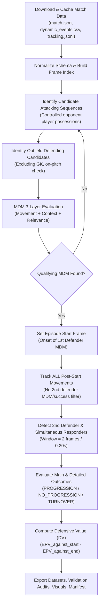

# Algorithm Specification — From First Pressure to Defensive Response

## 1. High-Level Architecture

The pipeline processes high-frequency tracking (10 FPS) and granular dynamic events to identify, track, and evaluate defensive coordination sequences (episodes).



---

## 2. Processing Stages and Decision Rules

### Stage 1: Data Ingestion and Validation
- **Inputs:** Dynamic URLs constructed from `--match-id`.
- **Outputs:** Verified, locally cached raw files (`data/raw/{match_id}/`).
- **Decision Rules:**
  - Verify HTTP status code (raise `FileNotFoundError` on 404, `ConnectionError` on non-200).
  - Verify `players` array, pitch dimensions (length: $104\text{ m}$, width: $68\text{ m}$), and home/away team attacking directions per period.
  - Parse 10 FPS tracking JSONL and build an in-memory dictionary mapping integer frame number to frame records.
- **Failure Modes:** Incomplete tracking file or corrupted JSONL records are logged and skipped without halting pipeline.

### Stage 2: Attacking Trigger Detection & Halfway Line Constraint (Wilayah Sendiri)
- **Inputs:** `dynamic_events.csv` (`event_type == 'player_possession'`), tracking ball data.
- **Outputs:** Filtered candidate possession sequences evaluated from halfway line entry into defending territory.
- **Decision Rules:**
  - Minimum possession duration: $\ge 5\text{ frames}$ ($0.5\text{ s}$).
  - Extract ball carrier ID, team ID, start/end frames, and attacking direction.
  - **Halfway Line Filter (`only_defending_half`):** The defensive calculation strictly begins when the ball crosses the halfway line ($x=0$) and enters the defending team's own half (wilayah sendiri: $x \ge 0$ when opponent attacks `left_to_right`; $x \le 0$ when opponent attacks `right_to_left`).
  - If the ball never enters the defending team's half during a possession, it is excluded. If it crosses halfway, the candidate evaluation window begins at the crossing frame.
- **Failure Modes:** Ball out of play or unassigned possession phases are discarded.

### Stage 3: Candidate First Defender & MDM Detection
- **Inputs:** Defending team outfield player IDs, tracking window over the candidate trigger sequence.
- **Outputs:** First Defender ID and Episode Start frame.
- **Decision Rules:**
  - **Layer 1 (Movement):** Sliding window of 5 frames ($0.5\text{ s}$). Peak speed $v \ge 1.5\text{ m/s}$ and displacement $\ge 0.6\text{ m}$ (permitting active 1v1 jockeying and containment steps).
  - **Layer 2 (Context):** Dynamic engagement event (`pressing`, `pressure`, `recovery_press`, etc.) OR distance closed toward ball carrier $\ge 0.8\text{ m}$, OR direct duel containment / jockeying where defender is already within close proximity ($\le 3.5\text{ m}$) to the ball carrier. Danger reduction metrics are recorded as supporting evidence but not required as prerequisites.
  - **Layer 3 (Relevance):** Initial distance to ball carrier $\le 25\text{ m}$ and not moving away by $> 3\text{ m}$.
  - Defender with earliest qualifying onset is selected as First Defender. Ties within $\le 2\text{ frames}$ ($0.20\text{ s}$) are resolved in favor of the defender closest to the ball carrier (`initial_distance_to_ball`).
- **Failure Modes:** If no defender satisfies all 3 layers, the possession sequence is deemed unpressured / uncontested and discarded.

### Stage 4: Post-Start Defensive Movement Observation
- **Inputs:** Tracking index, First Defender onset, episode frame bounds.
- **Outputs:** List of `DefenderMovementRecord`, Second Defender summary, coordination features.
- **Decision Rules:**
  - **No MDM Filter for Second / Supporting Defenders:** Every defender's trajectory is segmented at $v \ge 1.2\text{ m/s}$.
  - **Pre-Start Distinction:** Check defender speed in the 3 frames immediately preceding Episode Start. If speed $\ge 1.2\text{ m/s}$, flag as `is_pre_existing_continuation = True`.
  - **Second Defender Assignment:**
    - Filter candidate defenders strictly by initial proximity to First Defender at Episode Start ($\text{dist} \le 18.0\text{ m}$, `second_defender_max_distance_to_first_m`). Distant weak-side defenders beyond 18m are excluded from candidacy.
    - Among qualifying defenders within 18m, prioritization selects covering runs that close space toward the First Defender or achieve tight support ($d_{\min} \le 8.0\text{ m}$), evaluated by earliest post-start onset and minimum achieved distance.
    - If no new onset exists within 18m, an actively moving defender who closes space toward the First Defender is selected as continuation cover.
    - If no defender within 18m moves or is present, set `second_defender_id = None` (isolated press).
  - **Simultaneous Responders:** Any defender within 18m initiating movement within `simultaneous_tolerance_frames` ($2\text{ frames} = 0.20\text{ s}$) of the earliest onset is flagged as a simultaneous responder. In case of a tie, the closest defender to the First Defender is assigned as primary Second Defender.

### Stage 5: Episode End and Outcome Evaluation
- **Inputs:** Dynamic events and tracking from Episode Start to possession conclusion.
- **Outputs:** `main_outcome`, `detailed_outcome`, `evidence_dict`.
- **Decision Rules:**
  - `TURNOVER`: Attacking possession loss verified by event `end_type in ['possession_loss', 'clearance']` or defending team establishing immediate possession.
  - `PROGRESSION`: Forward ball displacement $\ge 8.0\text{ m}$ along the period's attacking axis, or completed shot / line break.
  - `NO_PROGRESSION`: Negative forward displacement ($\le -2.0\text{ m}$ recycled backward) or lateral stall without territory gain.
  - `UNRESOLVED`: Insufficient tracking or missing event evidence.

### Stage 6: EPV and Defensive Value Calculation
- **Inputs:** `dynamic_events.csv` EPV columns.
- **Outputs:** `epv_against_start`, `epv_against_end`, `defensive_value`.
- **Formula:**
  $$\text{DV} = \text{EPV}_{\text{against, start}} - \text{EPV}_{\text{against, end}}$$
- **Sign Rule:** Threat reduction yields positive DV; threat inflation yields negative DV.

---

## 3. Pseudocode

```python
def process_match(match_id, config):
    data = load_and_cache_data(match_id)
    tracking_idx = index_tracking(data.tracking)
    
    episodes, movements, features = [], [], []
    
    for seq in get_attacking_triggers(data.events):
        first_def = detect_first_defender_mdm(seq, tracking_idx, config)
        if not first_def:
            continue
            
        start_frame = first_def.onset_frame
        end_frame = determine_episode_end(seq, start_frame, config)
        
        # Fundamental: observe all defenders without MDM/success filter
        moves, sec_summary, coord = track_defenders(
            start_frame, end_frame, first_def, tracking_idx, config
        )
        
        main_out, det_out = evaluate_outcome(seq, start_frame, end_frame, data.events)
        dv = calculate_defensive_value(seq, start_frame, end_frame, data.events)
        
        episodes.append(build_episode_record(...))
        movements.extend(moves)
        features.append(coord)
        
    save_datasets(episodes, movements, features)
    generate_visuals(episodes, tracking_idx)
    save_manifest(match_id, config)
```
